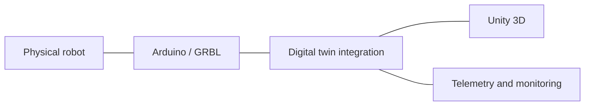

# Digital Twin of a 4-DOF Robot Tower

**Robotics · Digital Twin · Industrial IoT**

Bachelor's final-year engineering project integrating a physical R-P-P-R robot tower with a virtual representation and monitoring tools.

## Engineering highlights

- Physical robot actuation using Arduino, GRBL and stepper motor drives.
- Unity 3D virtual representation of the robot.
- MATLAB modeling and integration; InfluxDB and Grafana for telemetry and visualization.

## Project files

| File | Purpose |
| --- | --- |
| [2118-Design and Development of Digital Twin of a Robot Tower.pdf](2118-Design%20and%20Development%20of%20Digital%20Twin%20of%20a%20Robot%20Tower.pdf) | Original source or design file |
| [2118-Design and Development of Digital Twin of a Robot Tower.docx](2118-Design%20and%20Development%20of%20Digital%20Twin%20of%20a%20Robot%20Tower.docx) | Original source or design file |
| [FYP-1.rar](FYP-1.rar) | Original source or design file |
| [FYP-II.rar](FYP-II.rar) | Original source or design file |

## How to explore or reproduce

Read the project report first. The two RAR archives contain the original project deliverables; extract them locally and inspect their dependencies before running. Hardware configuration and calibration are required for physical operation.

## Scope and limitations

The repository is an archive of project deliverables, not yet a standalone installation package. A versioned setup guide, unpacked source tree and measured synchronization performance would make the project easier to reproduce.

## Portfolio

[Hassan Ali Janjua — Engineering portfolio](https://github.com/HassanAliJanjua03)
