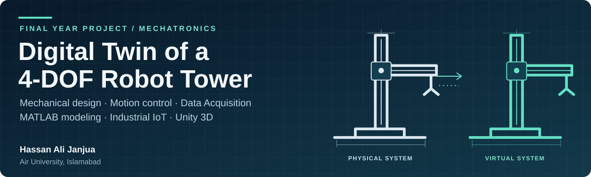
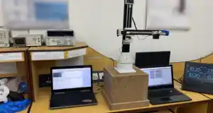
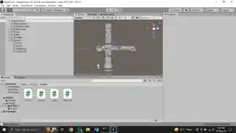
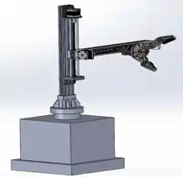
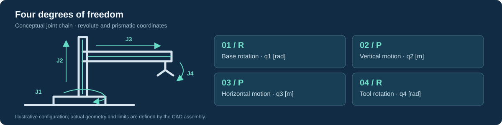
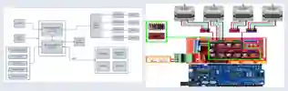
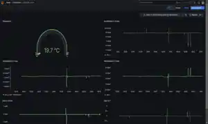
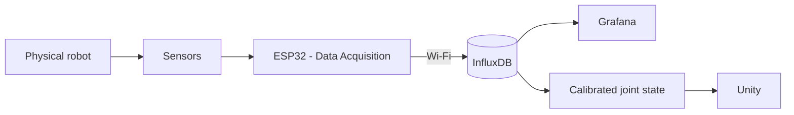
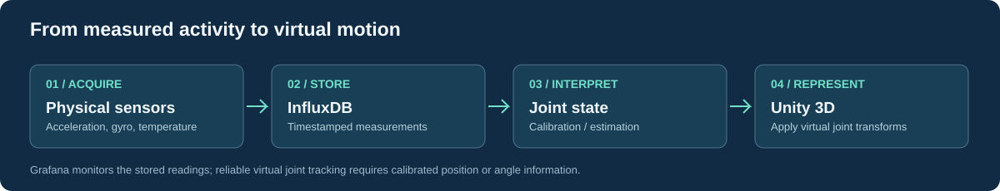

<div align="center">

<!-- IMAGE SECTION: Cover graphic. See assets/IMAGE_GUIDE.md. -->


<a href="#mechanical-design"></a>
<a href="#physical-robot"></a>
<a href="#modeling-control"></a>
<a href="#data-acquisition"></a>
<a href="#data-acquisition"></a>
<a href="#data-acquisition"></a>
<a href="#unity-3d-digital-twin"></a>

**Bachelor's Final Year Project · Mechatronics Engineering · Air University, Islamabad**

[Project overview](#the-idea-behind-my-project) · [System architecture](#how-i-connected-everything) · [Source code](#explore-the-repository) · [Full report](2118-Design%20and%20Development%20of%20Digital%20Twin%20of%20a%20Robot%20Tower.pdf)

<br>

<!-- IMAGE SECTION: Hero photographs: physical robot and Unity model. See assets/IMAGE_GUIDE.md. -->
<table>
<tr>
<td align="center" width="50%">
<a href="assets/previews/physical_prototype.webp"></a>
<br><b>THE PHYSICAL ROBOT</b><br><sub>Fabricated prototype · Motion control · Laboratory setup</sub>
</td>
<td align="center" width="50%">
<a href="assets/previews/unity_digital_twin.webp"></a>
<br><b>THE VIRTUAL ROBOT</b><br><sub>SolidWorks geometry · Unity scene · C# control</sub>
</td>
</tr>
</table>


</div>

## The idea behind my project

I wanted to explore how a real robotic mechanism could be connected to its digital representation. Rather than stopping at a CAD model or a simulation, I worked on bringing the physical robot, its mathematical model and real-time sensor readings into the same system.

I started with a four-axis robot tower in SolidWorks, moved on to the hardware and motion control, and used MATLAB to study its kinematics and joint behavior. The final part was connecting the physical system to a virtual robot in Unity 3D, with InfluxDB and Grafana handling data storage and monitoring.

**The objective:** make the virtual model follow the activity of the physical robot, while making its sensor readings accessible through a monitoring dashboard.

## How I connected everything


There are three connected parts to the system. The first is the physical robot and its motion-control hardware; the second is the data acquisition and monitoring pipeline; the third is the virtual model. MATLAB and Simscape provide the mathematical and dynamic modeling behind the robot.

| Physical system | Data acquisition | Virtual system |
| :--- | :--- | :--- |
| SolidWorks assembly, four motors, Arduino Uno, GRBL and CNC shield | ESP32, Wi-Fi, InfluxDB and Grafana | Imported CAD geometry, C# movement scripts and virtual joint control |

---

<a name="mechanical-design"></a>

## 01 / Mechanical design

### SolidWorks — designing the robot tower

I began by designing the robot's mechanical assembly. The vertical tower and horizontal axis provide two linear movements, while the base and tool-end joints provide rotational movement. I chose an R-P-P-R configuration to combine linear positioning with rotary motion.

<!-- IMAGE SECTION: SolidWorks CAD assembly. See assets/IMAGE_GUIDE.md. -->
<table>
<tr>
<td width="48%" align="center"><a href="assets/previews/solidworks_assembly.webp"></a><br><sub>Final mechanical assembly</sub></td>
<td width="52%" valign="top">

<b>Mechanical configuration</b>

<br><br>
<b>J1 · R</b> — Base rotation<br>
<b>J2 · P</b> — Vertical translation<br>
<b>J3 · P</b> — Horizontal translation<br>
<b>J4 · R</b> — Tool-end rotation

<br><br>

The assembly includes a supporting base, vertical tower, linear carriages, stepper-driven mechanisms and a gripper. The same geometry was used as the starting point for the virtual model and multibody representation.

</td>
</tr>
</table>



<details>
<summary><b>Design considerations and coordinate conventions</b></summary>

The motion of the mechanism depends on the coordinate frames assigned to each joint. I distinguish between rotational joint coordinates in radians and prismatic joint coordinates in metres when working with mathematical models. The conceptual joint map above is not a dimensioned manufacturing drawing. Measured dimensions and joint limits must be taken from the CAD assembly for numerical reproduction.

</details>

<a name="physical-robot"></a>

## 02 / Physical robot

### From the CAD assembly to hardware

I used an Arduino Uno running GRBL for the robot's motion-control side. The CNC shield connects the A4988 drivers to the stepper motors, while I used a separate ESP32 for data acquisition. The ESP32 collects sensor readings, holds the data for transmission and sends them to InfluxDB over Wi-Fi.

<!-- IMAGE SECTION: Hardware and wiring photographs. See assets/IMAGE_GUIDE.md. -->
<a href="assets/previews/hardware_overview.webp"></a>

<sub>System block diagram and Arduino / CNC shield wiring reference.</sub>

| Component | Role in the robot |
| :--- | :--- |
| Arduino Uno + GRBL | Interpret G-code and generate motion commands |
| CNC shield + A4988 | Interface between the controller and stepper motors |
| Four stepper motors | Joint actuation |
| Leadscrew and linear carriages | Convert motor rotation into linear displacement |
| ESP32 | Acquire and hold sensor readings; transmit data over Wi-Fi to InfluxDB |

<details>
<summary><b>View the motion-control sequence</b></summary>

The sequence I used includes incremental X/Z motion, a feed rate of 500 mm/min and dwell commands.

```gcode
G21 G91
G1 Z-20 X40 F500
M3 S1
G4 P1
G1 Z20 X-40 F500
G4 P1
```

[Full G-code sequence](hardware/original/robot_tower_motion_sequence.gcode.txt) · [Hardware notes and firmware conventions](hardware/original/README.md)

The archived sequence needs to be checked against the actual firmware and joint mapping before running it on hardware. Standard GRBL treats M3 S as a spindle command and M30 as program end.

</details>

<a name="modeling-control"></a>

## 03 / Modeling & control

### Stepper motor, kinematics and PID control in MATLAB

I wanted to understand the response of the robot before relying only on physical movement. For this, I divided the MATLAB work into actuator modeling, kinematics and joint-level control.

<!-- IMAGE SECTION: Simulink and Simscape model images. See assets/IMAGE_GUIDE.md. -->
<a href="assets/previews/modeling_overview.webp"></a>

<sub>My actuator model, forward kinematics, four-joint control system and Mechanics Explorer visualization.</sub>

#### Stepper motor model

I modeled the electrical and mechanical behavior of the actuator in Simulink, observing voltage, current, torque, angular velocity and angular displacement. The inertial transfer function in my model is:

```math
G(s)=\frac{\Theta(s)}{T(s)}=\frac{1}{2.327\times10^{-6}s^2}
```

#### Forward and inverse kinematics

Using Peter Corke's Robotics Toolbox, I modeled the R-P-P-R configuration and analyzed the end-effector trajectory. Forward kinematics gives the pose from the joint coordinates, while inverse kinematics finds a joint configuration for a reachable target.

<!-- IMAGE SECTION: MATLAB trajectory image. See assets/IMAGE_GUIDE.md. -->
<table>
<tr>
<td width="54%"><a href="assets/previews/inverse_kinematics_trajectory.webp"></a><br><sub>End-effector trajectory in MATLAB</sub></td>
<td width="46%" valign="top"><b>My modeling approach</b><br><br>1. Assign link coordinate frames.<br>2. Define the revolute and prismatic joints.<br>3. Compute homogeneous transformations.<br>4. Evaluate the end-effector pose and trajectory.<br><br><a href="simulation/kinematics/robot_kinematics.m">Explore MATLAB implementation →</a></td>
</tr>
</table>

```math
{}^0T_4=A_1(q_1)A_2(q_2)A_3(q_3)A_4(q_4)
```

#### Simscape Multibody & closed-loop PID

I used the mechanical model in Simscape Multibody to study the response of the four joints. Each joint has a PID loop. I logged the position signals and plotted their responses in MATLAB.

<details>
<summary><b>Controller settings and MATLAB analysis</b></summary>

These are the saved controller settings from my Simscape model, rounded for readability. Block names are retained because their exact association to joint numbers has not been independently checked.

| Controller block | Kp | Ki | Kd |
| --- | ---: | ---: | ---: |
| PID Controller | 2.0337 | 1420.3015 | 0.0006523 |
| PID Controller1 | 5,780,742.5542 | 22,528,675.7526 | 367,897.4903 |
| PID Controller2 | 12,391,278.5338 | 94,475,183.8411 | 395,685.4124 |
| PID Controller3 | 2.0337 | 1420.3015 | 0.0006523 |

These are simulation settings, not directly transferable physical hardware gains.

[Full PID parameters](docs/engineering-notes.md#pid-controller-settings) · [Original joint plots script](simulation/plotting.m) · [Combined joint plotting](simulation/plot_joint_responses.m)

</details>

[**Explore the MATLAB and Simscape module →**](simulation/README.md)

<a name="data-acquisition"></a>

## 04 / Data Acquisition

### From physical sensor readings to InfluxDB and Grafana

Once the robot could move, the next task was to observe what was happening on the physical system. I used an ESP32 to collect the readings from the sensors mounted on the robot. The readings were held on the ESP32 and transmitted over Wi-Fi to InfluxDB for time-series storage. I then used Grafana to visualize the sensor readings, trends and temperature.

<!-- IMAGE SECTION: InfluxDB and Grafana photographs. See assets/IMAGE_GUIDE.md. -->
<table>
<tr>
<td width="50%" align="center"><a href="assets/previews/influxdb_overview.webp"></a><br><b>InfluxDB</b><br><sub>Timestamped sensor records</sub></td>
<td width="50%" align="center"><a href="assets/previews/grafana_dashboard.webp"></a><br><b>Grafana</b><br><sub>Sensor readings, trends and temperature gauge</sub></td>
</tr>
</table>

| Signal | Data fields | Purpose |
| --- | --- | --- |
| Acceleration | `acc_x`, `acc_y`, `acc_z` | Observe changes in linear acceleration |
| Angular velocity | `gyro_x`, `gyro_y`, `gyro_z` | Observe rotational activity |
| Temperature | `temperature` | Monitor temperature |

The system architecture also identifies force and pressure sensing. The screenshots above show the acceleration, angular-rate and temperature data available in my monitoring interface.

<details>
<summary><b>Data pipeline, message structure and configuration</b></summary>



For reproducibility, the [data acquisition module](data-acquisition/README.md) includes a configurable MQTT-to-InfluxDB bridge, input validation and environment-based configuration. My original system diagram identifies MQTT; the exact ESP32 firmware and database transport configuration are not included here. The sample records in the test file are synthetic and are not experimental measurements.

</details>

[**Explore the Data Acquisition module →**](data-acquisition/README.md)

<a name="unity-3d-digital-twin"></a>

## 05 / Unity 3D digital twin

### Connecting the physical robot to its virtual representation

I imported my SolidWorks model into Unity 3D and organized its components into pivots, slides and control objects. I used C# to control rotational and translational movement, including virtual limit-switch behavior.

The purpose of the digital twin was to represent the movements of the physical robot in the virtual environment. Sensor readings collected by the ESP32 are transmitted over Wi-Fi to InfluxDB, while Grafana provides a view of the measured data. The virtual motion layer maps joint information onto the Unity model.

<!-- IMAGE SECTION: Unity digital twin images can be added here. See assets/IMAGE_GUIDE.md. -->


<details>
<summary><b>How the C# scripts are organized</b></summary>

| Script | Function |
| --- | --- |
| [Z_Slide.cs](unity/original/Z_Slide.cs) | Translation along the Unity Z-axis and limit-switch triggers |
| [ZSlide_Ctrl.cs.txt](unity/original/ZSlide_Ctrl.cs.txt) | Archived movement-direction controller excerpt |
| [JointStateReplay.cs](unity/JointStateReplay.cs) | Interpolation of calibrated joint-state records into virtual motion |

The replay controller uses joint positions and angles, not raw accelerometer readings as positions. Absolute displacement estimation from inertial data requires a suitable estimator or additional position feedback.

</details>

[**Explore the Unity 3D module →**](unity/README.md)

---

## 06 / Project outcome

The project brought together the mechanical design, a physical robotic prototype, mathematical modeling, joint-level control, sensor data acquisition, a monitoring dashboard and a virtual robotic model.

What I found most valuable was the integration: designing the mechanism was only one part of the task. The coordinate conventions, motor commands, sensor measurements and virtual motion all needed to make sense together.

For further development, I would focus on calibrated joint-position feedback and measuring physical-to-virtual synchronization error and delay. These are important metrics for evaluating a digital twin; I have not reported numerical results for them without measured evidence.

## Explore the repository

| Module | What to find |
| --- | --- |
| [Mechanical design & image gallery](assets) | CAD, prototype, simulations, dashboard and virtual model |
| [Hardware](hardware/original/README.md) | Motion sequence and electrical control notes |
| [MATLAB & Simscape](simulation/README.md) | Kinematics and joint-response scripts |
| [Data Acquisition](data-acquisition/README.md) | Sensor-data bridge, validation and setup |
| [Unity 3D](unity/README.md) | Virtual motion and joint-state replay |
| [Engineering notes](docs/engineering-notes.md) | Actuator model, kinematics and PID parameters |
| [Setup guide](docs/reproduction.md) | Software and reproduction workflow |
| [Models and demonstration index](docs/media-inventory.md) | Project images, simulation models and recordings |

<details>
<summary><b>Original project report and deliverables</b></summary>

- [Final Year Project report (PDF)](2118-Design%20and%20Development%20of%20Digital%20Twin%20of%20a%20Robot%20Tower.pdf)
- [Editable report (DOCX)](2118-Design%20and%20Development%20of%20Digital%20Twin%20of%20a%20Robot%20Tower.docx)
- [FYP I deliverables](FYP-1.rar)
- [FYP II deliverables](FYP-II.rar)

The kinematics, data acquisition and replay code includes later reconstructed modules for exploring the workflow. These need system-specific configuration and runtime validation. The report retains the original project attribution.

</details>

<div align="center">

---

**Hassan Ali Janjua**  
Mechatronics Engineering · Robotics · Control Systems · Industrial IoT · Digital Twins

[My engineering portfolio](https://github.com/HassanAliJanjua03)

</div>
