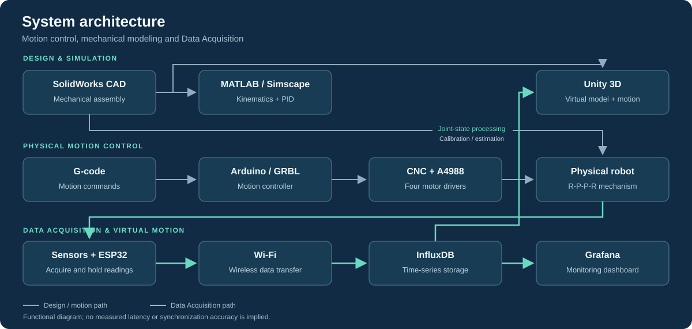
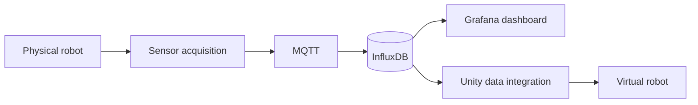

# Digital Twin of a 4-DOF Robot Tower

**SolidWorks · Arduino / GRBL · MATLAB / Simscape · MQTT · InfluxDB · Grafana · Unity 3D**

Bachelor's final-year project, Mechatronics Engineering, Air University, Islamabad.

The idea behind this project was to connect a real robotic mechanism to a virtual model rather than treat CAD, simulation and hardware as separate tasks. I designed a four-degree-of-freedom robot tower, developed its physical motion-control system, modeled the joints in MATLAB and Simscape, and worked on the data pipeline that allowed the Unity model to follow the physical robot's movements.

[Project report](2118-Design%20and%20Development%20of%20Digital%20Twin%20of%20a%20Robot%20Tower.pdf) · [Engineering details](docs/engineering-notes.md) · [Source and reproduction guide](docs/reproduction.md) · [Media inventory](docs/media-inventory.md)

## 1. Mechanical design — SolidWorks

The project started with a CAD assembly of an R-P-P-R robot tower: a revolute base, two linear axes and a final revolute joint. The design combines a vertical tower, horizontal carriage, lead-screw actuation and a gripper. SolidWorks geometry was used as the basis for the virtual representation in Unity and the mechanical modeling work in MATLAB/Simscape.

## 2. Physical robot and motion control

An Arduino Uno running GRBL receives G-code commands. A CNC shield and A4988 motor drivers interface with the four stepper motors. A second microcontroller is used for sensor telemetry in the project architecture. The original motion sequence is available in [hardware/original](hardware/original/README.md).

The recorded demonstration shows the physical prototype alongside the motion-control interface, Unity model and sensor dashboard. The demonstration media and CAD screenshots supplied separately are indexed in the [media inventory](docs/media-inventory.md); the binary media still need to be uploaded to this repository.

## 3. Motor modeling and robot kinematics

The stepper-motor Simulink model includes switched electrical excitation, mechanical loading and signals for voltage, current, torque, angular velocity and position. Its recorded transfer-function denominator is `[2.327e-6 0 0]`.

The robot was also modeled with Peter Corke's Robotics Toolbox for MATLAB, including forward kinematics and an end-effector trajectory associated with inverse kinematics. The original screenshots are part of the media package. A configurable [kinematics example](examples/matlab/robot_kinematics.m) illustrates the method; it is not the original script and requires measured DH parameters.

## 4. Dynamic simulation and joint control

The SolidWorks-based mechanical representation was modeled in Simscape Multibody with two revolute and two prismatic joints. Four PID controllers were tuned in the simulation. The [engineering notes](docs/engineering-notes.md#pid-controller-settings) record the actual saved gains extracted from the supplied SLX file. The [original plotting script](simulation/plotting.m) runs the robot model and plots Joint1–Joint4; a [cleaner plotting helper](examples/matlab/plot_joint_responses.m) is also provided.

## 5. Real-time sensing, InfluxDB and Grafana

The project's sensor architecture includes acceleration, gyroscope, force, pressure and temperature sensing. The supplied InfluxDB screenshots show acceleration and gyro readings on three axes, temperature and timestamped records. MQTT is shown in the system architecture as the telemetry transport. Grafana provides a temperature gauge and time-series plots for monitoring sensor activity.

This is a functional overview. The complete original acquisition and Unity database-client source was not supplied; the [MQTT-to-InfluxDB example](examples/telemetry/README.md) provides a separate reference implementation.

## 6. Virtual model — Unity 3D

The CAD model was imported into Unity 2019.3.5f1 and organized into pivots, slides and control objects. Sensor information from the physical system is used in the digital-twin workflow to drive virtual movement. The supplied [Z-axis scripts](unity/original/README.md) show manual movement and virtual limit-switch logic. A [supplementary replay controller](examples/unity/README.md) demonstrates calibrated joint-state mapping and a safe separation between raw inertial readings and position estimates.

Absolute prismatic displacement cannot be recovered reliably from uncalibrated acceleration alone. The examples therefore require calibrated joint-state inputs rather than presenting raw acceleration as position. The original end-to-end synchronization implementation and quantitative latency/error validation are not established by the available source files.

## 7. What the project demonstrates

| Engineering area | Evidence |
| --- | --- |
| Mechanical design | SolidWorks CAD assembly and physical prototype |
| Motion control | G-code sequence, Arduino/GRBL and CNC shield |
| Actuator simulation | Stepper motor SLX model and transfer function |
| Robotics | MATLAB kinematic visualizations and trajectory |
| Control engineering | Simscape model, four PID controllers and joint plotting |
| Industrial IoT | InfluxDB sensor records, Grafana dashboard |
| Digital twin | Unity virtual model and recorded demonstrations |

## Repository guide

| Location | Contents |
| --- | --- |
| [hardware/original](hardware/original/README.md) | Supplied G-code and controller notes |
| [simulation](simulation/README.md) | Original response plotting script and model inventory |
| [unity/original](unity/original/README.md) | Supplied Unity C# snippets |
| [examples](examples/README.md) | Newly prepared MATLAB, telemetry and Unity reference implementations |
| [docs](docs/engineering-notes.md) | System notes, reproduction and media inventory |
| [Original FYP-I archive](FYP-1.rar) / [FYP-II archive](FYP-II.rar) | Original project deliverables retained unchanged |

The new examples are supplementary, not retroactively claimed as original project code. MATLAB, hardware and Unity runtime tests were not performed during this documentation update.

[Engineering portfolio — Hassan Ali Janjua](https://github.com/HassanAliJanjua03)
