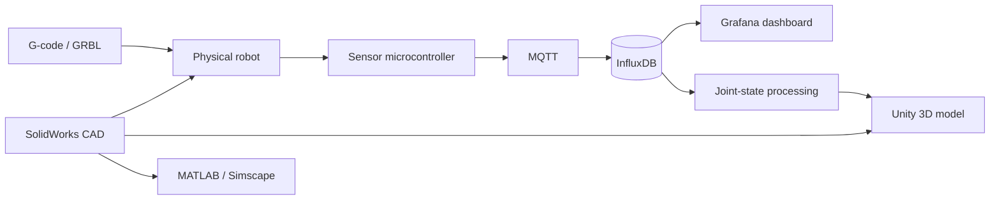
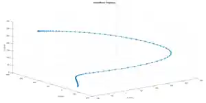
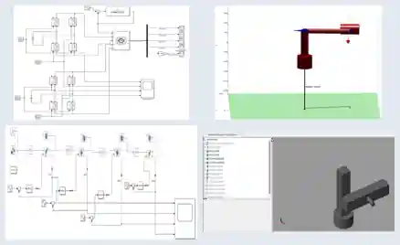
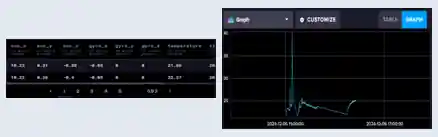

<div align="center">

# Digital Twin of a 4-DOF Robot Tower

### From a SolidWorks assembly to a sensor-driven virtual robot

**Hassan Ali Janjua · Final Year Project · Mechatronics Engineering · Air University, Islamabad**


[Project report](2118-Design%20and%20Development%20of%20Digital%20Twin%20of%20a%20Robot%20Tower.pdf) · [How it works](#how-the-system-works) · [MATLAB & Simscape](#3-mathematical-modeling-and-control) · [Digital twin](#5-digital-twin-in-unity-3d) · [Code](#repository-guide)

</div>

<table>
<tr>
<td align="center" width="50%"><br><b>Physical robot</b><br>Laboratory implementation</td>
<td align="center" width="50%"><br><b>Mechanical design</b><br>SolidWorks CAD assembly</td>
</tr>
<tr>
<td align="center"><br><b>Virtual robot</b><br>Unity 3D</td>
<td align="center"><br><b>Live telemetry</b><br>Grafana dashboard</td>
</tr>
</table>

## About the project

For my final-year project, I wanted to take a robotic system beyond its physical structure and connect it to a virtual environment. The challenge was not just to build a 3D model, but to bring mechanical design, motion control, sensor data and software together so that the virtual model could follow the physical robot.

I worked on the mechanical design, the hardware and motion-control setup, MATLAB modeling, the IoT monitoring pipeline and the Unity environment. The result was a four-degree-of-freedom robotic prototype with a corresponding virtual model and a dashboard for observing sensor activity.

| 4 DOF | 2 revolute + 2 prismatic joints | 4 stepper motors | 4 joint PID controllers |
| :---: | :---: | :---: | :---: |

## How the system works




The two paths are complementary: G-code drives the physical robot, while measured data travels through the IoT pipeline to monitor and represent its activity in the virtual environment.

## 1. Mechanical design in SolidWorks

I started with the mechanical assembly. The robot has an R-P-P-R configuration: a rotating base, vertical translation, horizontal translation and a final rotary joint at the tool end. The tower incorporates linear carriages, stepper-driven mechanisms, a support base and a gripper.

<p align="center"></p>

The SolidWorks geometry also provided the starting point for the Unity 3D model and the mechanical representation in Simscape Multibody.

## 2. Physical hardware and motion control

Once the design was ready, I moved to the physical prototype. The motion-control system used an Arduino Uno running GRBL, a CNC shield, A4988 drivers and four stepper motors. A separate microcontroller handles sensor data acquisition in the system architecture.

| Hardware | Role |
| --- | --- |
| Arduino Uno + GRBL | G-code interpretation and motion control |
| CNC shield + A4988 | Stepper motor driver interface |
| Four stepper motors | Joint actuation |
| Leadscrew and linear mechanisms | Rotary-to-linear motion |
| Sensors and telemetry controller | Movement and environmental data acquisition |

<p align="center"><br><em>System architecture and motor driver wiring</em></p>

[Hardware notes and G-code](hardware/original/README.md)

The G-code sequence combines incremental X/Z moves, feed-rate control and dwell commands. The archived sequence is documented for inspection, not blind execution on another machine.

## 3. Mathematical modeling and control

### Stepper motor simulation

Before analyzing the complete robot, I modeled the actuator in Simulink to study electrical excitation and mechanical response: voltage, current, torque, angular velocity and angular position. The mechanical transfer function shown in my model is

```math
G(s)=\frac{1}{2.327\times10^{-6}s^2}
```

### Forward and inverse kinematics

Using Peter Corke's Robotics Toolbox, I modeled the robot's joint configuration and end-effector motion. Forward kinematics determines the pose for a given joint configuration; inverse kinematics finds joint coordinates that satisfy the desired reachable pose.

<p align="center"><br><em>End-effector trajectory in MATLAB</em></p>

The kinematic chain is represented as the product of the four homogeneous transformations.

```math
{}^0T_4=A_1(q_1)A_2(q_2)A_3(q_3)A_4(q_4)
```

### Simscape Multibody and PID control

I used the mechanical model in Simscape Multibody and applied a separate PID loop to each of the four joints. Joint 1 and Joint 4 are rotational, while Joint 2 and Joint 3 are translational. I logged their responses to analyze the motion in MATLAB.

<p align="center"><br><em>Actuator model · Forward kinematics · Four-joint PID model · Mechanics Explorer</em></p>

[MATLAB kinematics](simulation/kinematics/robot_kinematics.m) · [Joint plotting](simulation/plotting.m) · [Combined response plotting](simulation/plot_joint_responses.m) · [PID settings and engineering notes](docs/engineering-notes.md#pid-controller-settings)

## 4. Sensor data, InfluxDB and Grafana

The next step was to capture what was happening on the real robot. Sensor readings were transmitted through the telemetry system and stored as timestamped records in InfluxDB. I created a Grafana dashboard to monitor the temperature, acceleration and gyroscope signals.

<p align="center"><br><em>My Grafana dashboard during sensor monitoring</em></p>

| Measurements | Data fields |
| --- | --- |
| Acceleration | acc_x, acc_y, acc_z |
| Angular velocity | gyro_x, gyro_y, gyro_z |
| Temperature | temperature |

<p align="center"><br><em>Sensor records and historical trends in InfluxDB</em></p>

The architecture also identifies force and pressure sensing. The dashboard makes it easier to observe trends and detect changes in sensor behavior while the robot is operating.

[Telemetry setup and MQTT-to-InfluxDB code](telemetry/README.md)

## 5. Digital twin in Unity 3D

This was the part where the mechanical and software work came together. I imported my SolidWorks model into Unity 3D (2019.3.5f1), organized its components into pivots and sliding assemblies, and used C# scripts to control the virtual joints.

<p align="center"><br><em>My Unity scene with the robot hierarchy and axis-control scripts</em></p>

The goal was for the virtual robot to mimic the physical robot's motion based on sensor data. InfluxDB stores the measurements, Grafana makes the data visible, and the Unity control layer maps joint information to the virtual model.

For reliable position tracking, raw accelerometer and gyroscope data need calibration and suitable state estimation or position feedback. The joint replay code uses calibrated positions and angles rather than treating acceleration as a position signal.

[Unity scripts and setup](unity/README.md) · [Joint-state replay](unity/JointStateReplay.cs)

## 6. What I learned from building this system

The most interesting part was seeing how every engineering decision affects the rest of the system: the CAD geometry determines the joint structure, the control system moves the mechanism, and the sensors and data pipeline provide the information needed to represent its behavior virtually.

This project gave me practical experience connecting robotics, numerical simulation, embedded control, industrial IoT and 3D software into one system.

## Repository guide

| Directory | What's inside |
| --- | --- |
| [assets](assets) | Project images and previews |
| [hardware](hardware/original/README.md) | Robot motion commands and hardware notes |
| [simulation](simulation/README.md) | MATLAB kinematics, Simscape response analysis and model guide |
| [telemetry](telemetry/README.md) | MQTT and InfluxDB data integration |
| [unity](unity/README.md) | C# motion-control and virtual joint replay |
| [docs](docs/engineering-notes.md) | Engineering calculations, PID settings and project resources |

[Full project report (PDF)](2118-Design%20and%20Development%20of%20Digital%20Twin%20of%20a%20Robot%20Tower.pdf) · [FYP I](FYP-1.rar) · [FYP II](FYP-II.rar) · [Model and demonstration index](docs/media-inventory.md) · [Setup guide](docs/reproduction.md)

The repository includes archived project code and later reconstruction of the kinematics, telemetry and replay modules to make the workflow easier to explore. These modules require configuration and testing on the original system. The report retains the project's academic attribution.

---

**Hassan Ali Janjua** · [Engineering portfolio](https://github.com/HassanAliJanjua03)
