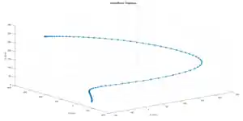

# Project gallery

These are images from my final-year project, arranged by subsystem. Click an image to open its preview.

| Mechanical design | Physical robot |
| --- | --- |
|  |  |
| **SolidWorks CAD** | **Laboratory prototype** |

| Hardware | MATLAB and Simscape |
| --- | --- |
|  |  |
| **System architecture and wiring** | **Actuator, kinematics and PID models** |

| MATLAB trajectory | Unity 3D |
| --- | --- |
|  |  |
| **End-effector trajectory** | **Virtual robot** |

| InfluxDB | Grafana |
| --- | --- |
|  |  |
| **Sensor records** | **Monitoring dashboard** |

The diagrams in [design](design) are functional illustrations, not CAD drawings or experimental results.

[Back to project](../README.md) · [Full media index](../docs/media-inventory.md)
