# Project gallery

My project images are organized by subsystem. Every image has a fixed filename in [images](images); uploading a matching image makes it appear here and in the relevant project sections.

### Physical robot prototype

[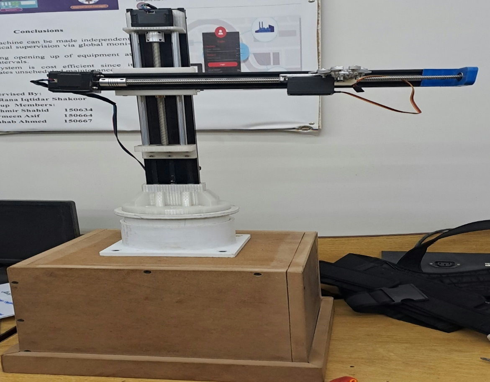](images/physical_prototype.png)

### Final SolidWorks assembly

[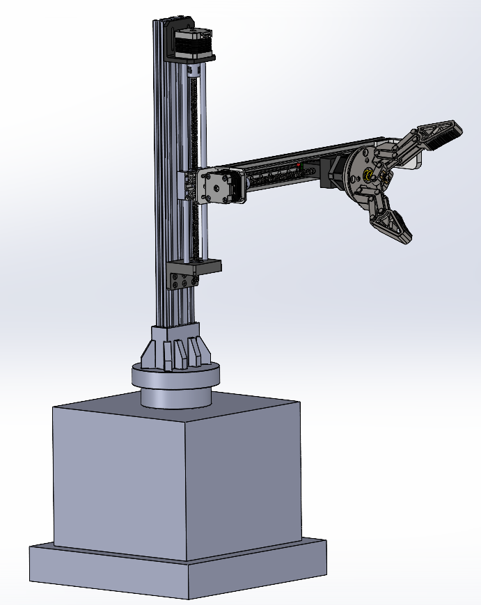](images/solidworks_assembly.png)

### Earlier CAD assembly

[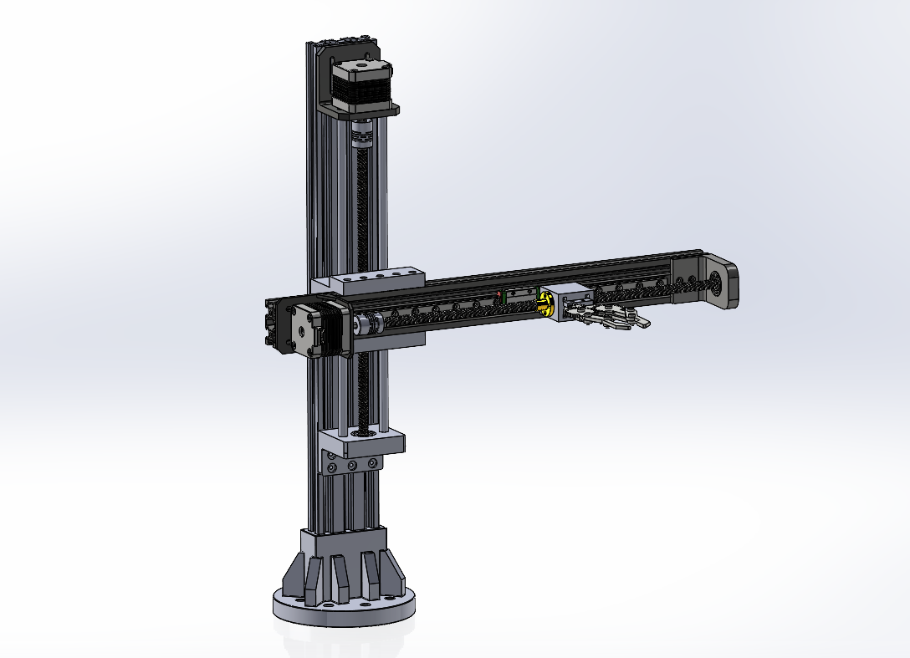](images/solidworks_assembly_earlier.png)

### Original system block diagram

[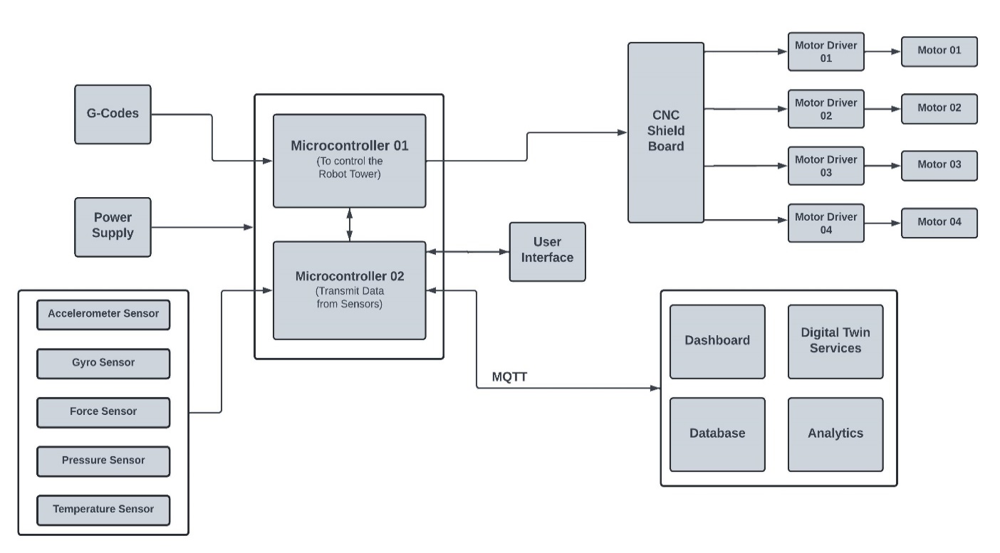](images/system_architecture.png)

### Arduino CNC shield wiring

[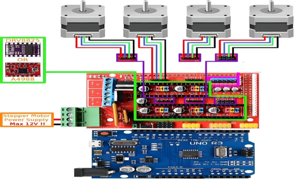](images/arduino_cnc_wiring.png)

### ESP32 sensor data acquisition setup

[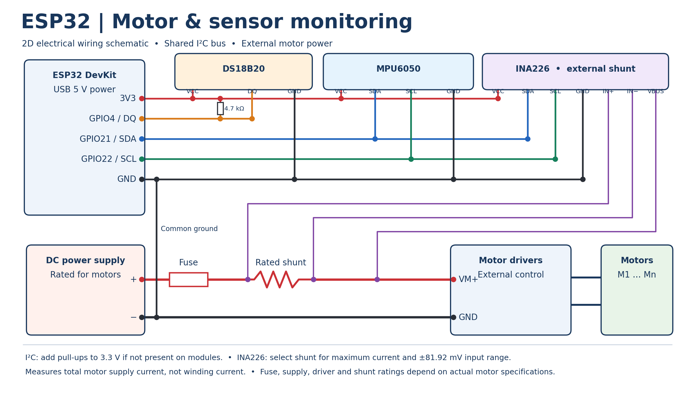](images/esp32_setup.png)

### Stepper motor Simulink model

[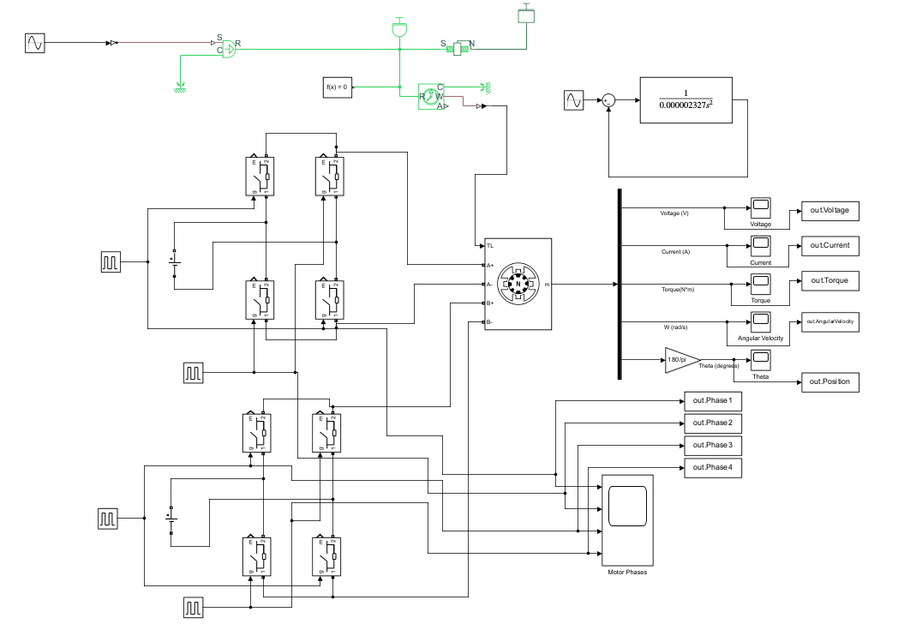](images/stepper_motor_simulink.png)

### MATLAB forward kinematics

[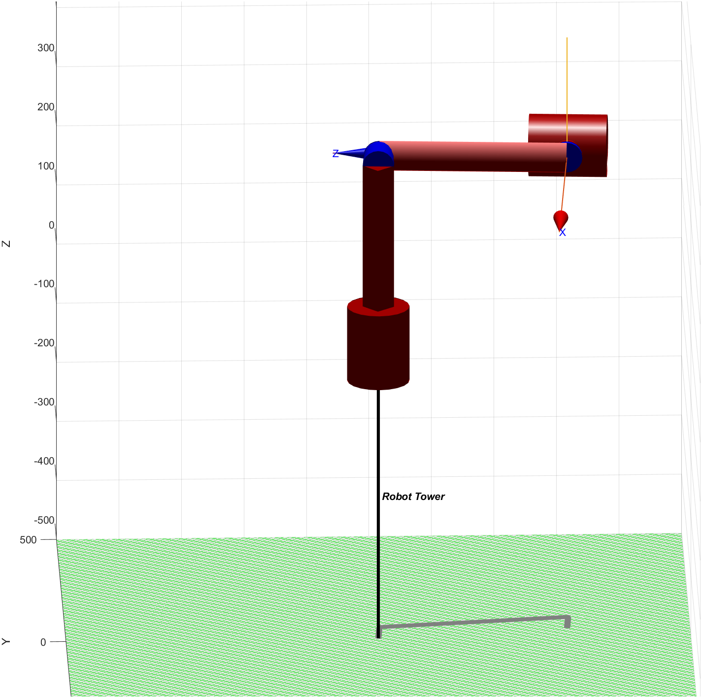](images/forward_kinematics.png)

### MATLAB inverse kinematics trajectory

[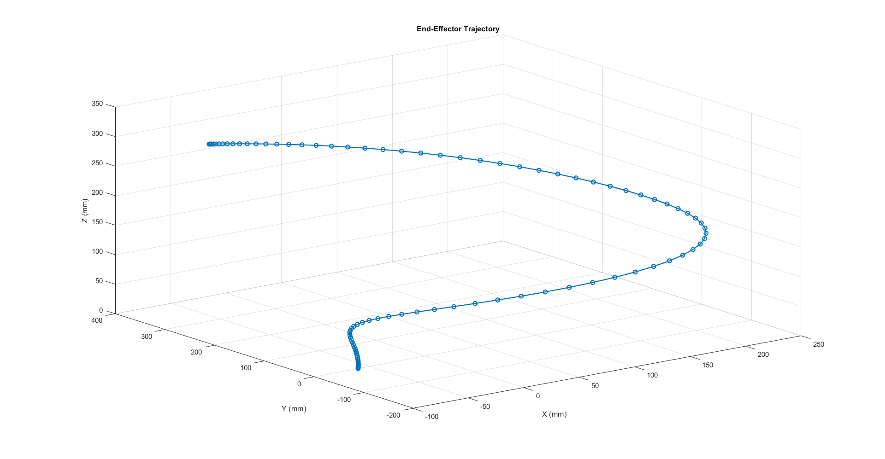](images/inverse_kinematics_trajectory.png)

### Simscape Multibody PID model

[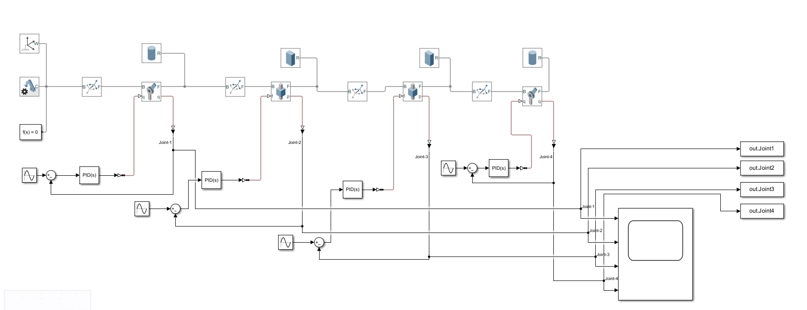](images/simscape_pid_model.png)

### Simscape Mechanics Explorer

[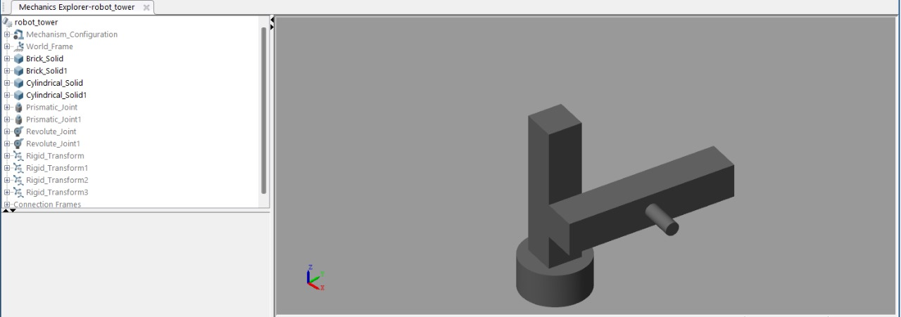](images/simscape_mechanics_explorer.png)

### InfluxDB sensor data table

[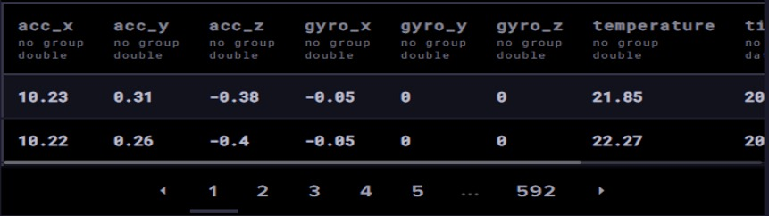](images/influxdb_sensor_table.png)

### InfluxDB time-series graph

[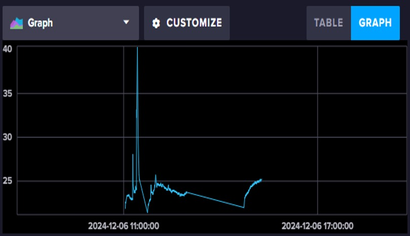](images/influxdb_timeseries.png)

### Grafana dashboard

[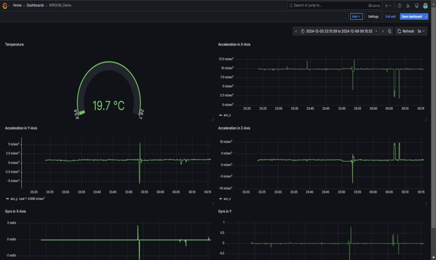](images/grafana_dashboard.png)

### Unity 3D digital twin

[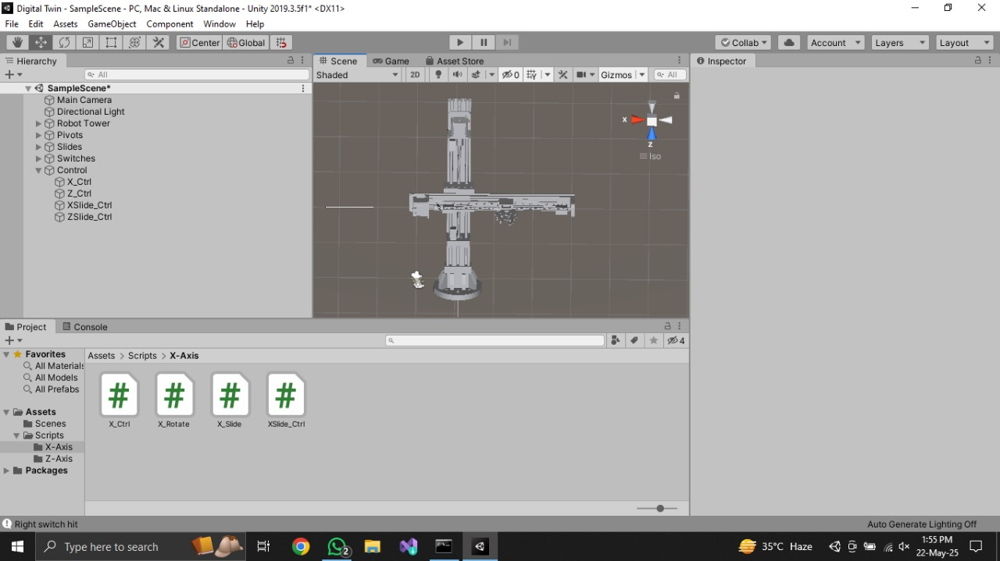](images/unity_digital_twin.png)

The diagrams in [design](design) are functional illustrations, not CAD drawings or experimental results.

[Back to project](../README.md) · [Media upload guide](IMAGE_GUIDE.md)
