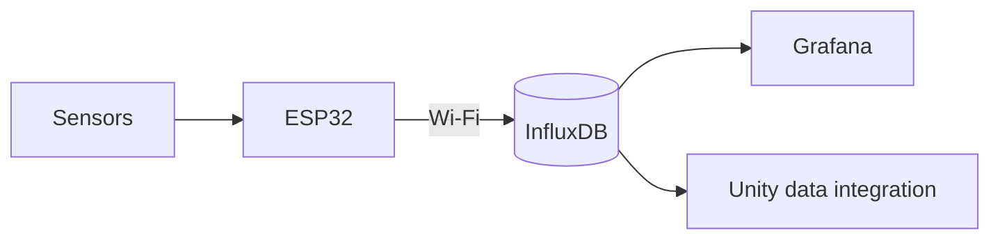
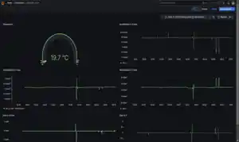

# Data Acquisition | ESP32, Wi-Fi, InfluxDB & Grafana

I used an ESP32 as the data acquisition microcontroller. It collects the sensor readings, holds the acquired data for transmission and sends them over Wi-Fi to InfluxDB. I used Grafana to display the stored readings and monitor the robot's activity. The Arduino Uno is dedicated to motion control, separate from the ESP32.



My original system diagram identifies MQTT. The Python bridge below provides a configurable MQTT-based way to reproduce the data acquisition pipeline; the exact original ESP32 firmware and transport settings are not included.



## Data format

The data bridge expects a JSON object with one or more numeric acceleration, gyroscope and temperature fields. It accepts an optional Unix timestamp in nanoseconds. Confirm units and calibration against the real sensor setup.

```json
{"acc_x": 9.81, "acc_y": 0.0, "acc_z": 0.0, "gyro_x": 0.0, "temperature": 22.0}
```

The example above is synthetic; it only illustrates the message structure.

## Run the configurable MQTT bridge

```bash
python -m pip install -r requirements.txt
python mqtt_to_influx.py
```

Set the variables described in [.env.example](.env.example) in your shell or deployment environment (the script does not automatically load a .env file). Use a TLS broker, an HTTPS database endpoint and limited-access credentials. Never commit actual credentials.

## Check the data parser

```bash
python -m unittest -v test_sensor_data.py
```

The tests cover valid data, missing fields, invalid timestamps, non-finite numbers and malformed JSON. They do not require a broker or database. The live bridge requires the dependencies above and system-specific configuration.

| File | Purpose |
| --- | --- |
| [mqtt_to_influx.py](mqtt_to_influx.py) | MQTT subscriber and InfluxDB writer |
| [sensor_data.py](sensor_data.py) | Sensor message validation |
| [test_sensor_data.py](test_sensor_data.py) | Offline parser checks |
| [.env.example](.env.example) | Configuration variable reference |

## Grafana

Configure an InfluxDB data source, select the robot_sensors measurement, and create panels for acceleration (three axes), angular velocity (three axes) and temperature. Review timestamp ranges and units before interpreting the readings.

The bridge and parser are reconstructed code for reproducing the project workflow; connection to the original hardware still needs to be tested.

[Back to project](../README.md)
