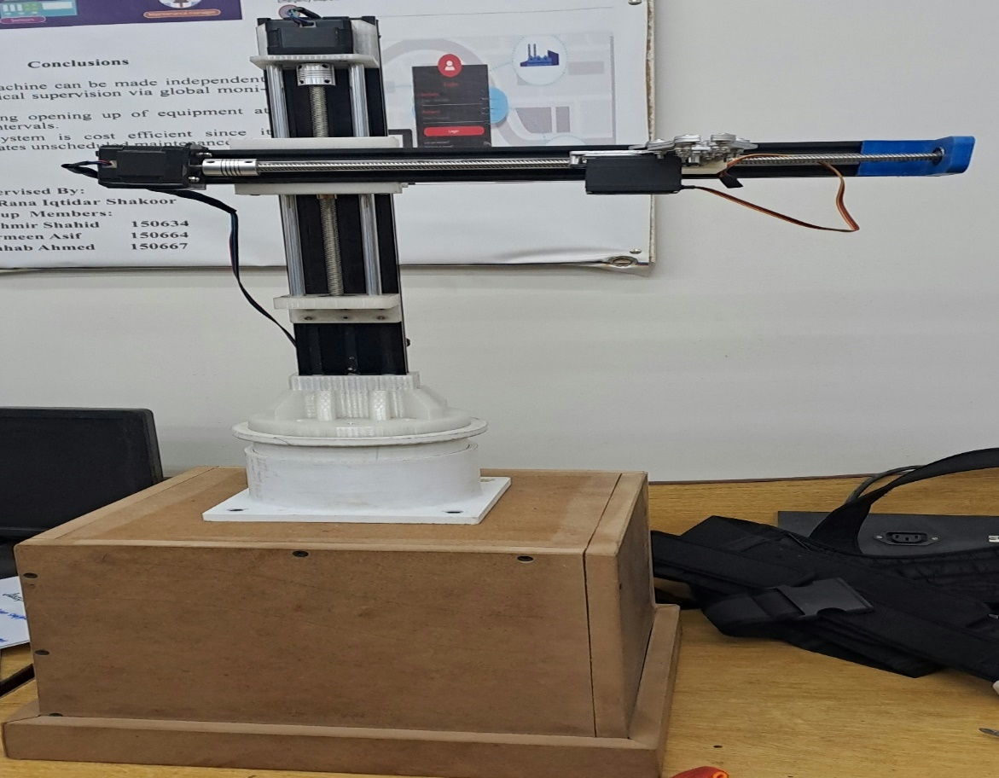
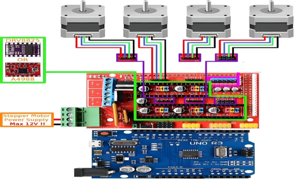
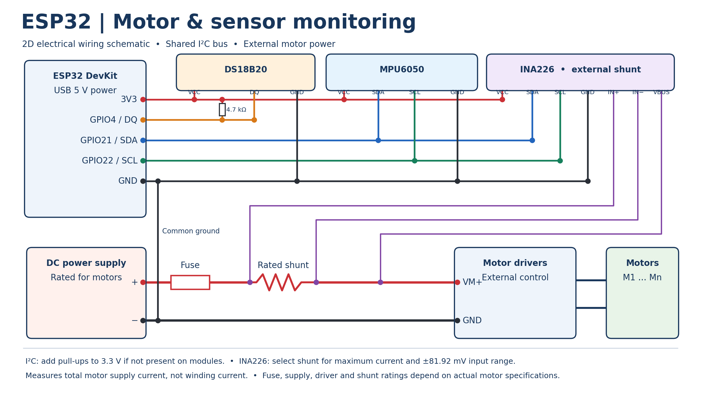

# Physical motion control

My motion-control setup consists of an Arduino Uno with GRBL, a CNC shield and A4988 drivers connected to the stepper motors. I used a separate ESP32 for sensor data acquisition and Wi-Fi transmission to InfluxDB. See the [Data Acquisition module](../../data-acquisition/README.md).

[Physical robot demonstration](../../demonstrations/physical_robot.mp4)

[Robot tower G-code sequence](robot_tower_motion_sequence.gcode.txt)

The recorded sequence uses incremental X/Z movements (G21, G91 and G1), a feed rate of 500 mm/min and dwell commands. I keep this sequence as a record of the project. M30 is normally a program-end command, and M3 S is a spindle setpoint in standard GRBL, so check the firmware mapping, travel limits, current settings and emergency stop before adapting the sequence to hardware. The fifth iteration reverses the X movement.
