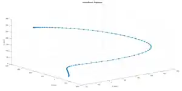

# MATLAB & Simscape

I used MATLAB for two parts of the project: mathematical modeling of the R-P-P-R robot with Peter Corke's Robotics Toolbox, and simulation of the mechanical system in Simscape Multibody.

| File | Purpose |
| --- | --- |
| [kinematics/robot_kinematics.m](kinematics/robot_kinematics.m) | Configurable forward and inverse kinematics |
| [plotting.m](plotting.m) | Four individual joint responses from the robot_tower model |
| [plot_joint_responses.m](plot_joint_responses.m) | Combined joint response figure |

For the kinematic model, enter the measured standard DH parameters and joint limits. For the response plots, make sure robot_tower.slx is on the MATLAB path. See [engineering notes](../docs/engineering-notes.md#pid-controller-settings) for the PID gains and [model index](../docs/media-inventory.md) for the two SLX models. The reconstructed kinematics and plotting helper have not been run in MATLAB since they were organized here.
