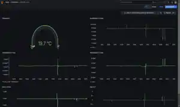

# Sensor data pipeline



I used InfluxDB to store timestamped sensor readings and Grafana to visualize them. MQTT is the communication layer in the system architecture.

## MQTT to InfluxDB

[mqtt_to_influx.py](mqtt_to_influx.py) is a configurable reconstruction of the data bridge. It accepts numeric acceleration, gyroscope and temperature fields in JSON, optionally with a Unix nanosecond timestamp. It writes telemetry only; it does not send movement commands.

Install the dependencies:

```bash
python -m pip install -r requirements.txt
```

Set MQTT_HOST, MQTT_PORT (default 8883), MQTT_TOPIC, MQTT_USERNAME, MQTT_PASSWORD, INFLUX_URL, INFLUX_TOKEN, INFLUX_ORG and INFLUX_BUCKET as environment variables. Use TLS for MQTT and HTTPS for InfluxDB, then run `python mqtt_to_influx.py`. Use a test bucket and a limited-access token; don't commit credentials.

Configure Grafana's InfluxDB data source to plot the robot_sensors measurement. Confirm the units, timestamps and calibration on the hardware before interpreting the readings.
