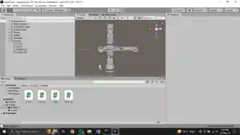

# Unity 3D digital twin

I imported the SolidWorks model into Unity 2019.3.5f1 and organized the pivots, slides and control objects to represent the four robotic joints.

| Script | Function |
| --- | --- |
| [Z_Slide.cs](original/Z_Slide.cs) | Translation, movement flags and virtual limit-switch triggers |
| [ZSlide_Ctrl.cs.txt](original/ZSlide_Ctrl.cs.txt) | Archived controller excerpt |
| [JointStateReplay.cs](JointStateReplay.cs) | Calibrated virtual motion from recorded joint data |

The archived controller excerpt is incomplete. The replay module is a reconstruction for reproducing joint movement in a copy of the scene, not the original live database client.

## Replay setup

Attach JointStateReplay.cs to an empty GameObject. Assign four joint transforms and local axes, measured motion limits and metres-to-Unity-units scale. Assign a TextAsset with CSV header `time_s,q1_rad,q2_m,q3_m,q4_rad` and ascending relative timestamps starting at zero. Joint values are absolute offsets relative to the calibrated rest pose. The script interpolates samples and limits motion to the configured virtual range.

For live operation, supply calibrated joint state via an authenticated data service. Keep database credentials out of Unity builds. Raw inertial data are not absolute joint positions.
